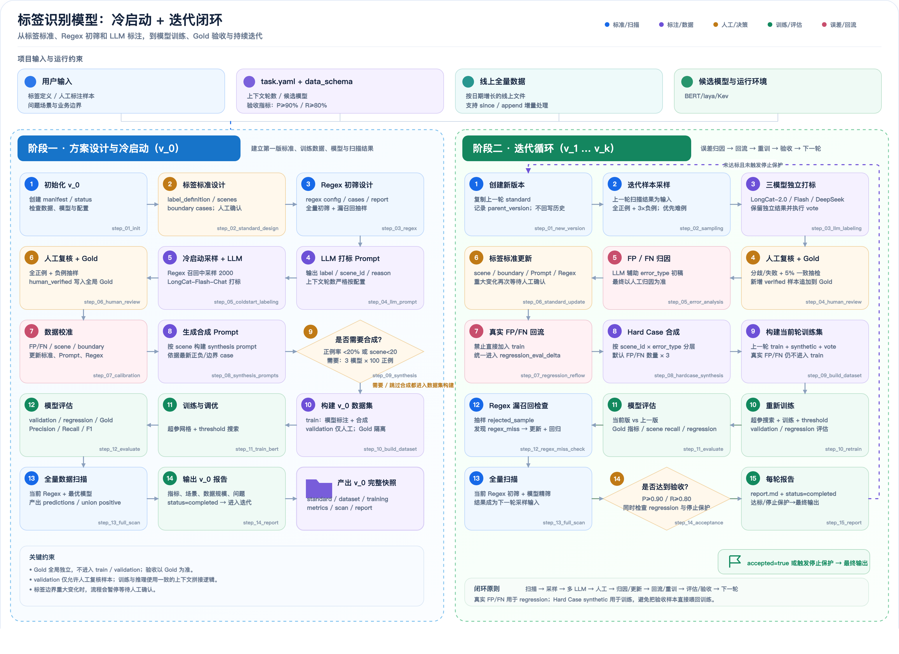

# Binary Label Skill

**标签检测的自动化方案设计与迭代** —— 一个用于构建和持续优化 Turn 级二分类检测模型的 Claude Code Skill。

从一句标签定义和少量人工标注样本出发，自动完成检测器的方案设计（标签标准 → Regex 初筛 → LLM 标注 → 人工复核 → 数据合成 → 模型训练 → 全量扫描），并以误差归因驱动的迭代闭环持续改进，直至满足验收指标（默认 P≥0.90 / R≥0.80）。

整体流程图：



> 交互版（动画流程线、节点 hover）见 [`two_stage_workflow.html`](two_stage_workflow.html)，可直接用浏览器打开；矢量版见 [`two_stage_workflow.svg`](two_stage_workflow.svg)。完整执行契约以 [`SKILL.md`](SKILL.md) 为准，本 README 只做概览。

---

## 方案总览：两阶段闭环

### 阶段一 · 方案设计与冷启动（产出 `v_0`）

从零建立第一版检测器，用户只需提供标签定义、少量人工标注样本和业务场景，其余环节自动推进：

```text
标签标准设计 → Regex 初筛 → 冷启动采样 + LLM 打标 → 人工复核 + Gold
→ 数据校准 → （按需）数据合成 → 构建数据集 → 训练与调优 → 模型评估
→ 全量扫描 → v_0 报告
```

关键设计：

- **Regex 初筛 + 模型精筛两级漏斗**：先从按日期增长的线上全量数据中低成本召回候选，再用模型精筛，支持 `--since/--until/--append` 增量处理；
- **LLM 打标自动化**：按细分子场景设计的 Prompt 输出 `label / scene_id / reason`，上下文轮数严格按配置；
- **人工只看该看的**：复核范围收敛为全正例 + 负例抽样（含边界 case），核验结果写入全局 Gold；
- **数据自动校准**：基于 FP/FN / scene / boundary 分析反哺标准、Prompt 与 Regex，再进入合成与训练。

### 阶段二 · 迭代循环（`v_1` … `v_k`）

每轮以上一轮的全量扫描结果为输入，自动执行「归因 → 修复 → 重训 → 验收」：

```text
全量扫描 → 迭代采样 → 三模型独立打标 + vote → 人工复核 + Gold
→ FP/FN 归因 → 标签标准更新 → 真实 FP/FN 回流 regression → Hard Case 合成
→ 构建训练集 → 重新训练 → 模型评估（当前版 vs 上一版）→ Regex 漏召回检查
→ 全量扫描 → 验收判定 → 未达标自动进入下一轮
```

关键设计：

- **误差归因驱动迭代**：LLM 辅助生成 `error_type` 初稿、人工终审，修复手段按归因类型路由（改标准 / 改 Prompt / 改 Regex / 合成 Hard Case / 重训）；
- **防指标污染**：真实 FP/FN 只进 `regression_eval`，不直接入 train；Gold 全局隔离，验收以 Gold 为准；Hard Case 合成数据按 `scene_id × error_type` 分层（默认 FP/FN 数量 × 3）用于训练；
- **自动验收与停止保护**：每轮对照 `acceptance` 指标 + regression 回归 + 停止保护条件，达标或触发保护即输出最终模型，否则自动开启下一轮；
- **全程版本化**：每个版本沉淀完整快照（standard / dataset / training / metrics / scan / report），历史版本只读。

## 人工介入点

自动化不等于无人值守。以下节点强制暂停等待人工确认，其余环节自动推进：

- 标签标准 / 边界 case 的重大变更；
- 人工复核与 Gold 合入；
- FP/FN 归因终审（LLM 只出初稿）。

## 仓库结构

```text
binary_label_skill/
├── SKILL.md                  # Skill 主契约：数据格式、版本规则、验收标准
├── two_stage_workflow.html   # 两阶段工作流全景图
├── workflows/
│   ├── cold_start.md         # 阶段一：方案设计与冷启动（产出 v_0）
│   └── iteration.md          # 阶段二：迭代循环（v_1, v_2, …）
├── scripts/                  # 流水线脚本（入口，均支持 --root / --version / --model）
├── src/                      # 共享库（上下文拼接、Regex 引擎、LLM 客户端、laya/kev 打分等）
└── templates/                # task.yaml / data_schema.yaml / manifest.yaml / status.yaml 模板
```

## 工作流路由

启动时在目标模型的版本链上查找当前最大版本 `v_k`：

| 状态 | 动作 |
| --- | --- |
| 无任何版本目录 | 进入阶段一（`workflows/cold_start.md`），创建 `<model>/v_0` |
| `v_k` 未 `completed` | 按 `status.yaml` 的 `current_step` 从断点恢复 |
| `v_k` 已 `completed` | 进入阶段二（`workflows/iteration.md`），创建 `v_{k+1}` |

多个候选模型 = 多条独立版本链，互不干扰、不跨模型比较。候选类型支持：

- **BERT 类**（macbert / h256 / h288 等）：完整走合成 → 微调 → 超参搜索 → 阈值搜索；
- **laya 零训练类**（`type: laya`）：跳过训练类步骤，靠 question 定义 + threshold 搜索获得检测能力，迭代手段为改 question 措辞 / 调阈值 / 改 Regex。

## 脚本一览

| 脚本 | 用途 |
| --- | --- |
| `run_regex_prefilter.py` | Regex 初筛线上数据 + 回归测试（支持增量） |
| `label_llm.py` / `llm_vote.py` | LLM 打标 / 多 LLM 结果投票合并 |
| `export_review_input.py` / `import_human_review.py` | 人工复核输入表导出 / 导入校验 |
| `build_gold.py` | 人工核验样本合入全局 Gold（按 `sample_id` 去重） |
| `generate_synthetic.py` | 数据合成（场景补充 / hard case 分层） |
| `build_dataset.py` | 构建 train / validation / regression_eval |
| `train_bert.py` / `hparam_search.py` | BERT 微调（单组超参）/ 超参网格搜索（支持多卡分片） |
| `tune_threshold.py` | validation 上 threshold 搜索（BERT / laya 均支持） |
| `select_model.py` / `evaluate.py` | 单模型统一评估 / 总体 + 子场景指标与 FP/FN 明细 |
| `classify_errors.py` | FP/FN LLM 辅助归因 |
| `full_scan.py` | Regex 初筛 + 模型精筛全量扫描（支持分片与增量） |
| `sample_iteration_data.py` | 迭代候选池采样 |

## 使用方式

1. 在项目根目录按 `templates/task.yaml` 初始化 `task.yaml`（标签定义、业务场景、上下文轮数、候选模型、验收指标等）；
2. 在 Claude Code 中触发本 Skill：请求新建安全/合规类二分类检测器、搭建数据标注闭环，或对已有检测模型做 FP/FN 归因与迭代；
3. Skill 自动路由冷启动或迭代流程，只在人工复核等关键节点暂停等待确认。

LLM 接入读 `task.yaml` 的 `llm_api` 配置，缺省回退环境变量 `LLM_BASE_URL` / `LLM_API_KEY`。

## 运行环境

- Python 3.12
- 依赖：`pandas` / `pyyaml` / `openpyxl` / `torch` / `transformers` / `sklearn` / `openai`
- laya 候选额外需要 `laya` 包（`pip install laya`，或将本地 checkout 加入 `PYTHONPATH`）
- 线上全量数据与候选模型默认挂载于内部路径（见 `SKILL.md` §5），可在 `task.yaml` 中覆盖
